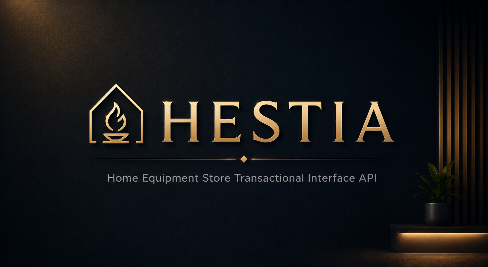
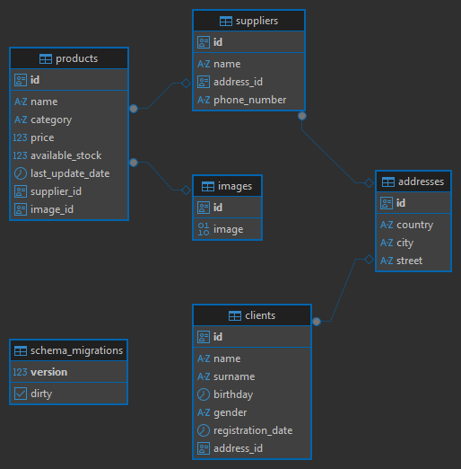
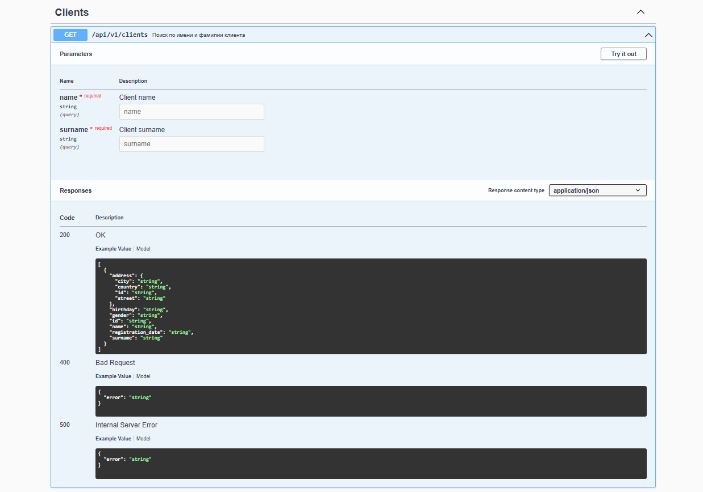

  


# HESTIA - Home Equipment Store Transactional Interface API

REST API для магазина бытовой техники, разработанный на Go (Gin) и PostgreSQL.  
Поддерживает управление клиентами, продуктами, поставщиками и изображениями с полной документацией через Swagger UI.

## Возможности

- **CRUD-операции** для клиентов, продуктов, поставщиков и изображений
- **Поиск клиентов** по имени и фамилии с пагинацией
- **Управление складом** - уменьшение остатка с проверкой доступного количества
- **Каскадное обновление адресов** (клиенты, поставщики)
- **Загрузка изображений** в формате `multipart/form-data`
- **Валидация входных данных** с возвратом детализированных ошибок
- **HTTP-статусы** 200/201/204, 400, 404, 409, 500
- **Документация OpenAPI 3.0** (Swagger UI) доступна из коробки
- **Контейнеризация** через Docker и docker-compose
- **Миграции БД** с `golang-migrate`

## Стек

       

## Быстрый старт

### Предварительные требования

- [Docker](https://www.docker.com/)
- [Docker Compose](https://docs.docker.com/compose/)

### Запуск

```bash
git clone <repo-url> && cd src
docker compose up --build
```

После сборки и старта контейнеров:

- **API:** `http://localhost:8080`
- **Swagger UI:** `http://localhost:8080/swagger/index.html`

### Локальная разработка (без Docker)

```bash
cp .env.example .env   # отредактируйте под свои настройки
make build
make migrate-up
make run               # или go run ./cmd/server
```

## API Endpoints

Все маршруты начинаются с префикса `/api/v1`.

### Клиенты

| Метод  | URL                          | Описание                     |
|--------|------------------------------|------------------------------|
| POST   | `/clients`                   | Создать клиента              |
| DELETE | `/clients/:id`               | Удалить клиента              |
| GET    | `/clients?name=...&surname=` | Поиск по имени и фамилии     |
| GET    | `/clients/all?limit=&offset=`| Получить всех клиентов       |
| PATCH  | `/clients/:id/address`       | Обновить адрес клиента       |

### Продукты

| Метод  | URL                          | Описание                     |
|--------|------------------------------|------------------------------|
| POST   | `/products`                  | Создать продукт              |
| PATCH  | `/products/:id/decrease`     | Уменьшить остаток            |
| GET    | `/products/:id`              | Получить продукт по ID       |
| GET    | `/products`                  | Получить доступные продукты  |
| DELETE | `/products/:id`              | Удалить продукт              |

### Поставщики

| Метод  | URL                          | Описание                     |
|--------|------------------------------|------------------------------|
| POST   | `/suppliers`                 | Создать поставщика           |
| PATCH  | `/suppliers/:id/address`     | Обновить адрес поставщика    |
| DELETE | `/suppliers/:id`             | Удалить поставщика           |
| GET    | `/suppliers`                 | Получить всех поставщиков    |
| GET    | `/suppliers/:id`             | Получить поставщика по ID    |

### Изображения

| Метод  | URL                            | Описание                     |
|--------|--------------------------------|------------------------------|
| POST   | `/images`                      | Загрузить изображение        |
| PUT    | `/images/:id`                  | Заменить изображение         |
| DELETE | `/images/:id`                  | Удалить изображение          |
| GET    | `/images/:id`                  | Получить изображение по ID   |
| GET    | `/images/product/:productId`   | Получить изображение продукта|

## Модель базы данных

**Основные таблицы:** `addresses`, `clients`, `suppliers`, `products`, `images`.  
Связи реализованы через внешние ключи. Все первичные ключи - `UUID`.  
Индексы созданы для полей, участвующих в поиске (`clients.name`, `clients.surname`, `products.category`, `products.available_stock`).



## Структура проекта

```text
hestia/
├── cmd/server/               # Точка входа
├── internal/
│   ├── config/               # Загрузка конфигурации из env
│   ├── database/
│   │   ├── migrations/       # SQL-файлы миграций
│   │   └── postgres.go       # Подключение к БД, запуск миграций
│   ├── dto/                  # Объекты передачи данных (запросы/ответы)
│   ├── handler/              # HTTP-обработчики
│   │   ├── middleware/       # Логирование
│   │   └── *_test.go         # Интеграционные тесты
│   ├── mapper/               # Маппинг DTO <-> модели
│   ├── models/               # DAL-модели (структуры таблиц)
│   ├── repository/           # Интерфейсы + Postgres-реализации
│   └── service/              # Бизнес-логика
├── docs/                     # Сгенерированная Swagger-документация
├── .env                      # Переменные окружения
├── docker-compose.yml        # Оркестрация контейнеров
├── Dockerfile                # Сборка образа
├── Makefile                  # Удобные команды
└── go.mod / go.sum
```

## Документация

Swagger-документация генерируется автоматически при сборке контейнера или локально командой `make swagger`.  
Интерактивный UI доступен по `/swagger/index.html`.

## Скриншоты

| Swagger UI | API Пример |
|------------|------------|
|  |  |

## Команды Makefile

```makefile
run          – запуск docker compose up --build
build        – сборка бинарника
swagger      – генерация документации
migrate-up   – применение миграций
migrate-down – откат миграций
test         – запуск тестов с генерацией документации
```

## Тестирование

Тесты покрывают создание, валидацию, удаление и обработку ошибок всех сущностей. Используются моки репозиториев. Запуск:

```bash
cd hestia
make test
```

## Конфигурация

Приложение конфигурируется через переменные окружения (прописаны в `docker-compose.yml`). Пример `.env`:

```env
SERVER_PORT=8080
DB_HOST=db
DB_PORT=5432
DB_USER=postgres
DB_PASSWORD=postgres
DB_NAME=store
DB_SSLMODE=disable
```

## Лицензия

MIT License. См. [LICENSE](LICENSE) для подробностей.

## Планы по развитию

- [ ] Аутентификация и авторизация (JWT)
- [ ] Пагинация для списка товаров
- [ ] Фильтрация товаров по категории и цене
- [ ] Хранение изображений в S3/MinIO (вместо BYTEA в БД)
- [ ] Метрики Prometheus

## Внесение изменений (Contributing)

1. Форкните репозиторий
2. Создайте ветку: `git checkout -b feature/your-feature`
3. Внесите изменения и добавьте тесты
4. Убедитесь, что все тесты проходят: `make test`
5. Отправьте pull request


## Контакты

Автор: [4vertak](https://github.com/4vertak)  
По вопросам: открывайте Issue в GitHub.
