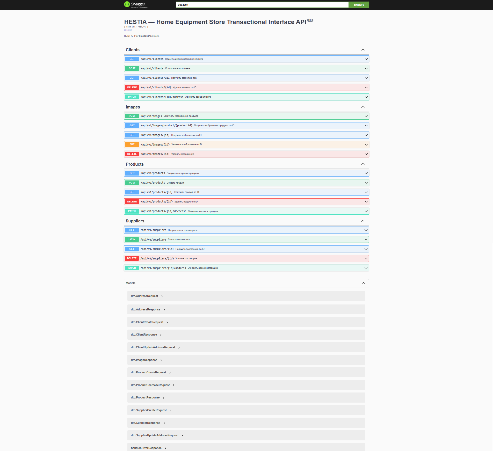

  


# HESTIA - Home Equipment Store Transactional Interface API

REST API для магазина бытовой техники, разработанный на Go (Gin) и PostgreSQL.  
Поддерживает управление клиентами, продуктами, поставщиками и изображениями с полной документацией через Swagger UI.

## Возможности

- **CRUD-операции** для клиентов, продуктов, поставщиков и изображений
- **Поиск клиентов** по имени и фамилии с пагинацией
- **Управление складом** - уменьшение остатка с проверкой доступного количества
- **Каскадное обновление адресов** (клиенты, поставщики)
- **Загрузка изображений** в формате `multipart/form-data`
- **Валидация входных данных** с возвратом детализированных ошибок
- **HTTP-статусы** 200/201/204, 400, 404, 409, 500
- **Документация Swagger 2.0** со Swagger UI
- **Контейнеризация** через Docker и docker-compose
- **Миграции БД** с `golang-migrate`

## Стек

     

## Быстрый старт

### Предварительные требования

- Для контейнерного запуска: [Docker](https://www.docker.com/) с работающим Engine и [Docker Compose v2](https://docs.docker.com/compose/).
- Для локальной сборки: Go 1.25 или новее; для команд Makefile также GNU Make и POSIX shell.
- Для локального запуска: PostgreSQL 16 с созданной БД и ролью с правами выполнения миграций (включая `pgcrypto`). Можно запустить только сервис `db` через Compose.
- При первом скачивании Go-модулей и образов нужен доступ к сети. Генератор Swagger запускается через Go с закреплённой версией; отдельная установка CLI `swag` или `migrate` не требуется.

### Запуск

```bash
git clone https://github.com/4vertak/hestia.git
cd hestia/src
cp .env.example .env
# Отредактируйте .env: задайте собственный непустой DB_PASSWORD.
make run-docker        # или docker compose up --build
```

После сборки и старта контейнеров:

- **API:** `http://localhost:8080`
- **Swagger UI:** `http://localhost:8080/swagger/index.html`
- **Swagger JSON:** `http://localhost:8080/swagger/doc.json`

По умолчанию сервисы публикуются только на `127.0.0.1`: API на 8080, PostgreSQL на 5433. `SERVER_PORT` меняет порт API, `DB_PORT` — опубликованный порт PostgreSQL. Внутри Compose приложение всегда использует `db:5432`. Для остановки: `make docker-down`. Именованный том сохраняет БД между запусками; новые учётные данные инициализации требуют нового тома либо явного изменения роли в существующей БД.

### Локальная разработка (без Docker)

```bash
cd hestia/src
cp .env.example .env   # задайте DB_PASSWORD и адрес своей PostgreSQL
# При использовании PostgreSQL из Compose: docker compose up -d db
make build
make run-local         # make run — такой же локальный запуск
# Альтернатива: go run ./cmd/server
```

Приложение читает `.env` из текущего каталога, если файл существует; переменные окружения имеют приоритет. Для внешней PostgreSQL укажите её host и port (обычно 5432). Для БД из Compose пример уже задаёт `127.0.0.1:5433`.

Сборка и проверки из чистого клона не требуют `.env`, работающей БД или предварительной генерации Swagger:

```bash
cd hestia/src
go build ./...
go test ./...
go vet ./...
```

SQL-миграции включены в бинарник через `go:embed` и выполняются автоматически при старте. Бинарник можно запускать из другого каталога, передав настройки через окружение; отдельная папка `migrations` рядом с ним не требуется.

## API Endpoints

Все маршруты начинаются с префикса `/api/v1`.

### Клиенты

| Метод  | URL                          | Описание                     |
|--------|------------------------------|------------------------------|
| POST   | `/clients`                   | Создать клиента              |
| DELETE | `/clients/:id`               | Удалить клиента              |
| GET    | `/clients?name=...&surname=` | Поиск по имени и фамилии     |
| GET    | `/clients/all?limit=&offset=`| Получить всех клиентов       |
| PATCH  | `/clients/:id/address`       | Обновить адрес клиента       |

### Продукты

| Метод  | URL                          | Описание                     |
|--------|------------------------------|------------------------------|
| POST   | `/products`                  | Создать продукт              |
| PATCH  | `/products/:id/decrease`     | Уменьшить остаток            |
| GET    | `/products/:id`              | Получить продукт по ID       |
| GET    | `/products`                  | Получить доступные продукты  |
| DELETE | `/products/:id`              | Удалить продукт              |

### Поставщики

| Метод  | URL                          | Описание                     |
|--------|------------------------------|------------------------------|
| POST   | `/suppliers`                 | Создать поставщика           |
| PATCH  | `/suppliers/:id/address`     | Обновить адрес поставщика    |
| DELETE | `/suppliers/:id`             | Удалить поставщика           |
| GET    | `/suppliers`                 | Получить всех поставщиков    |
| GET    | `/suppliers/:id`             | Получить поставщика по ID    |

### Изображения

| Метод  | URL                            | Описание                     |
|--------|--------------------------------|------------------------------|
| POST   | `/images`                      | Загрузить изображение        |
| PUT    | `/images/:id`                  | Заменить изображение         |
| DELETE | `/images/:id`                  | Удалить изображение          |
| GET    | `/images/:id`                  | Получить изображение по ID   |
| GET    | `/images/product/:productId`   | Получить изображение продукта|

## Модель базы данных

**Основные таблицы:** `addresses`, `clients`, `suppliers`, `products`, `images`.  
Связи реализованы через внешние ключи. Все первичные ключи - `UUID`.  
Индексы созданы для полей, участвующих в поиске (`clients.name`, `clients.surname`, `products.category`, `products.available_stock`).


## Структура проекта

```text
hestia/src/
├── cmd/server/               # Точка входа
├── internal/
│   ├── config/               # Загрузка конфигурации из env
│   ├── database/
│   │   ├── migrations/       # SQL-файлы миграций
│   │   └── postgres.go       # Подключение к БД, запуск миграций
│   ├── dto/                  # Объекты передачи данных (запросы/ответы)
│   ├── handler/              # HTTP-обработчики
│   │   └── middleware/       # Логирование
│   ├── mapper/               # Маппинг DTO <-> модели
│   ├── models/               # DAL-модели (структуры таблиц)
│   ├── repository/           # Интерфейсы + Postgres-реализации
│   └── service/              # Бизнес-логика
├── docs/                     # Сгенерированная Swagger-документация в Git
├── .env.example              # Шаблон; локальный .env не включается в Git
├── docker-compose.yml        # Оркестрация контейнеров
├── Dockerfile                # Сборка образа
├── Makefile                  # Удобные команды
└── go.mod / go.sum
```

## Документация

Спецификация имеет формат **Swagger 2.0**, не OpenAPI 3.0. Файлы `src/docs/docs.go`, `swagger.json`, `swagger.yaml` включены в Git: прямые Go-команды и Dockerfile используют их без установки генератора. Миграции и зарегистрированная документация входят в бинарник.

После изменения Swagger-аннотаций выполните из `src`:

```bash
make swagger          # генератор github.com/swaggo/swag/cmd/swag@v1.16.6
make swagger-check    # повторная генерация во временный каталог и сравнение
```

Сгенерированные файлы следует коммитить вместе с аннотациями. `make build/test/vet` явно зависят от `docs/docs.go`; при его отсутствии документация генерируется. `make clean` удаляет только бинарники. Dockerfile не перегенерирует документацию, поэтому перед сборкой образа после изменения аннотаций выполните `make swagger-check`.

UI доступен по `/swagger/index.html`, JSON — по `/swagger/doc.json`. В спецификации `basePath` равен `/`, а пути уже содержат `/api/v1`; префикс добавляется один раз.

## Скриншоты

| Swagger UI | API Пример |
|------------|------------|
|  |  |

## Команды Makefile

```makefile
run          – локальный запуск (алиас run-local)
run-local    – сборка и локальный запуск с загрузкой .env приложением
run-docker   – docker compose up --build
docker-down  – остановка Compose без удаления тома БД
build        – сборка бинарника
swagger      – обновление сохранённой документации
swagger-check – проверка актуальности сохранённой документации
migrate-up   – применение встроенных миграций без запуска HTTP-сервера
migrate-down – откат всех миграций (удаление таблиц и данных)
test         – go test с передачей ошибки в make
vet          – go vet
clean        – удаление бинарников; docs сохраняется
```

## Тестирование

Есть целевые тесты загрузки конфигурации и формирования строки подключения. Тестового покрытия CRUD, валидации и бизнес-ошибок всех сущностей нет; наличие моков репозиториев его не подтверждает. Запуск:

```bash
cd hestia/src
make test
make vet
make swagger-check
```

`make test` не фильтрует вывод через конвейер и завершается неуспешно при ошибке `go test`. Эти проверки не заменяют запуск с настоящей PostgreSQL. После старта можно проверить безопасные GET-запросы:

```bash
curl -f http://localhost:8080/swagger/index.html
curl -f http://localhost:8080/swagger/doc.json
curl -f http://localhost:8080/api/v1/products
```

В пустой базе список продуктов сейчас возвращается как JSON `null`; бизнес-логика этого ответа не изменена.

## Конфигурация

Скопируйте `src/.env.example` в `src/.env` и задайте собственный пароль. Реальные `.env` игнорируются Git и Docker build context. Пример намеренно не содержит готового пароля:

```env
SERVER_PORT=8080
DB_HOST=127.0.0.1
DB_PORT=5433
DB_USER=hestia
DB_PASSWORD=
DB_NAME=store
DB_SSLMODE=disable
```

Для приложения приоритет: переменные окружения, затем локальный `.env`, затем значения по умолчанию. У `DB_PASSWORD` нет встроенного пароля: пустое значение останавливает запуск с понятной ошибкой. Сборка и тесты пароль не требуют. Строковые пароли в `.env` можно заключать в одинарные кавычки; файл не выполняется как shell-скрипт.

Compose читает `.env` для подстановки и требует непустой `DB_PASSWORD` уже при проверке конфигурации. Параметры `DB_USER` и `DB_NAME` используются при инициализации PostgreSQL; внутри контейнера приложения `DB_HOST=db` и `DB_PORT=5432` заданы отдельно от локального адреса БД. Остальные значения из примера подходят для локальной разработки; для существующей внешней БД задайте её параметры и подходящий `DB_SSLMODE`.

## Лицензия

MIT License. См. [LICENSE](LICENSE) для подробностей.

## Планы по развитию

- [ ] Аутентификация и авторизация (JWT)
- [ ] Пагинация для списка товаров
- [ ] Фильтрация товаров по категории и цене
- [ ] Хранение изображений в S3/MinIO (вместо BYTEA в БД)
- [ ] Метрики Prometheus

## Внесение изменений (Contributing)

1. Форкните репозиторий
2. Создайте ветку: `git checkout -b feature/your-feature`
3. Внесите изменения и добавьте тесты
4. Убедитесь, что все тесты проходят: `make test`
5. Отправьте pull request


## Контакты

Автор: [4vertak](https://github.com/4vertak)  
По вопросам: открывайте Issue в GitHub.
